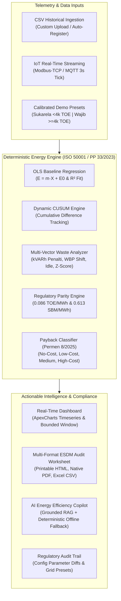

# Industrial Energy Efficiency Copilot (IEEC)
### Prototype Alpha v1.2 — Industrial Decarbonization & Statutory Energy Audit Engine

[](https://php.net)
[](https://laravel.com)
[](https://tailwindcss.com)
[](https://apexcharts.com)
[-brightgreen?style=flat)](tests)
[](audit)
[](LICENSE)

---

## 1. Executive Summary & Problem Owner Context

The **Industrial Energy Efficiency Copilot (IEEC)** is an industrial-grade energy management system, deterministic calculation engine, and AI copilot designed for Indonesian manufacturing and processing plants.

Developed for the **AngelHack Hackathon**, IEEC was engineered around the operational requirements of industry problem owner **PT Indmira Global Energi** — an integrated biomass processing and biochar pyrolysis facility operating industrial rotary dryers, furnace induction fans, high-pressure utility compressors, and administrative buildings.

### The Problem
Traditional industrial energy management in Indonesia faces four critical operational bottlenecks:
1. **Spreadsheet Delays & Inaccuracy:** Audits are typically conducted on disconnected spreadsheets once every 2–3 years, failing to catch real-time operational drifts or abnormal standby consumption.
2. **Expensive Grid Penalties:** Power factor anomalies ($\text{Cos }\phi < 0.85$) incur substantial monthly PLN kVARh surcharge penalties, while unmanaged peak operations during WBP (*Waktu Beban Puncak*, 18:00–22:00 WIB) trigger higher tariff multipliers ($K = 1.4\times - 1.5\times$).
3. **Statutory Ambiguity:** Facilities struggle to track whether their aggregate energy consumption triggers the mandatory threshold of $\ge 4.000\text{ TOE/tahun}$ under **Peraturan Pemerintah (PP) No. 33 Tahun 2023**.
4. **Unclassified Prescriptions:** Audit recommendations frequently fail to comply with the statutory investment classifications mandated by **Permen ESDM No. 8 Tahun 2025**.

### The Solution
IEEC provides continuous sub-distribution panel (SDP) telemetry analytics, deterministic linear regression baselines conforming to **ISO 50001 / ISO 50006:2014**, an LLM-powered AI Copilot grounded in validated engineering data, and instant multi-format reporting for official **Kementerian ESDM** audit submissions.

---

## 2. Core Capabilities & Architecture



### Key Technical Pillars

1. **Deterministic Calculation Integrity (ISO 50006 & PP 33/2023):**
   - **Zero Hardcoded Overrides:** All baseline metrics, idle/spike anomalies, and payback periods recalculate dynamically whenever operational data or tariffs change.
   - **Ordinary Least Squares (OLS) Baselines:** Calculates baseline energy slope $m$, baseload intercept $E_0$, and coefficient of determination $R^2$ dynamically.
   - **Dynamic CUSUM:** Tracks cumulative sum of differences over time to identify continuous efficiency gains or degradation.
   - **Regulatory Energy Equivalence:** Integrates statutory conversion coefficients:
     - Electricity: $0.086\text{ TOE/MWh}$
     - Fuel Equivalence: $0.613\text{ SBM/MWh}$ (Standar Ditjen EBTKE Kementerian ESDM)
   - **Building IKE Evaluation (Permen ESDM 3/2025):** Supports conditioned building evaluations for both standard facilities ($\le 5.000\text{ m}^2$) and large industrial buildings ($> 5.000\text{ m}^2$).

2. **Multi-Vector Financial Waste Detection:**
   - **Denda Penalti Daya Reaktif (Cos φ Rendah):** Quantifies billable kVARh whenever average power factor falls below the PLN standard of $0.85$.
   - **Beban Puncak WBP (18:00 - 22:00 WIB):** Identifies shiftable production load and evaluates cost differential using tariff multiplier $K$.
   - **Idle Load Waste:** Measures consumption during non-production periods and break shifts above baseline $E_0$.
   - **Transient Spike Anomalies:** Detects equipment irregularities via panel-specific statistical Z-score calculations ($Z > 2.0$).

3. **Permen ESDM No. 8 Tahun 2025 Payback Classification Matrix:**
   - Automatically computes simple payback period: $\text{Payback} = \frac{\text{Capex}}{\text{Annual Savings}}$
   - Classifies recommendations into statutory tiers:
     - **Tanpa Biaya (No-Cost):** Payback = 0
     - **Biaya Rendah (Low-Cost):** Payback $< 2\text{ Tahun}$
     - **Biaya Menengah (Medium-Cost):** $2\text{ Tahun} \le \text{Payback} \le 4\text{ Tahun}$
     - **Biaya Tinggi (High-Cost):** Payback $> 4\text{ Tahun}$

4. **Multi-Format Official ESDM Audit Worksheet Export (FR-08):**
   - **HTML View:** Printable browser worksheet with native `window.print()` styles.
   - **Native PDF Download (`?format=pdf`):** Powered by `barryvdh/laravel-dompdf`, styled with clean vector tables, embedded Indmira branding, and formal sign-off sections.
   - **Excel Spreadsheet / CSV (`?format=excel`):** Streams structured CSV with UTF-8 BOM (`\xEF\xBB\xBF`) containing Facility Metadata, SDP Panel Matrix, Multi-Vector Waste, and the Payback Matrix.
   - **Legal Integrity:** Employs formal template placeholders (`[Nama Manajer Energi Bersertifikat]`, `Reg. BNSP: [Nomor Registrasi]`) and a bold simulation disclaimer banner.

5. **Live IoT Telemetry Streaming & Canvas Synchronization (FR-05):**
   - 3-second polling pipeline simulating Modbus-TCP / MQTT industrial sensor data (`/api/stream-iot`).
   - Dynamically pushes live active power and baseline points into ApexCharts timeseries with a bounded 60-point sliding window.
   - Safe toggle state management prevents duplicate intervals or memory leaks.

6. **Air-Gapped & Offline Resilient (F-10):**
   - 100% local Vite asset bundling. Zero external CDN dependencies on Tailwind CSS or ApexCharts, enabling operation in isolated factory environments.

7. **Hackathon-Safe Parameter Locking & Rate Limiting (F-03):**
   - Server-side immutability locks the statutory 4,000 TOE threshold.
   - Applied `throttle:30,1` on `/chat` and `/upload` endpoints to protect LLM quotas while maintaining zero login friction for live hackathon jury demonstrations.

---

## 3. Technology Stack

- **Backend Framework:** [Laravel 12.x](https://laravel.com) running on **PHP 8.4**
- **Database:** SQLite (local development / demo) / MySQL compatible
- **Frontend & Styling:** [Tailwind CSS v4](https://tailwindcss.com), Vanilla CSS, Blade Templates
- **Interactive Visualizations:** [ApexCharts v4.0](https://apexcharts.com) (bundled locally via Vite)
- **Document Export:** [Barryvdh Laravel DomPDF](https://github.com/barryvdh/laravel-dompdf) & Native Streamed CSV with UTF-8 BOM
- **AI & Copilot:** Google Gemini API with grounded telemetry context injection & deterministic offline fallback
- **Build Tool:** [Vite v8.3](https://vitejs.dev)
- **Testing & Quality:** [PHPUnit 11](https://phpunit.de), [Laravel Pint](https://laravel.com/docs/pint)

---

## 4. Quickstart & Installation

### Prerequisites
- **PHP 8.4+** with `sqlite3`, `mbstring`, `xml`, `curl`, `gd` extensions enabled
- **Composer 2.x**
- **Node.js 18+** & **npm**

### Installation Steps

1. **Clone the Repository:**
   ```bash
   git clone https://github.com/VernSG/Angel-Hack.git
   cd Angel-Hack
   ```

2. **Install PHP & JavaScript Dependencies:**
   ```bash
   composer install
   npm install
   ```

3. **Configure Environment:**
   ```bash
   cp .env.example .env
   php artisan key:generate
   ```

4. **Initialize Database & Seed Data:**
   ```bash
   touch database/database.sqlite
   php artisan migrate --seed
   ```

5. **Build Local Frontend Assets:**
   ```bash
   npm run build
   ```

6. **Launch Development Server:**
   ```bash
   php artisan serve
   ```
   Open your browser at `http://localhost:8000`.

---

## 5. Automated Testing & Verification

The application features comprehensive automated feature and regression tests covering all analytical formulas, regulatory boundaries, file exports, and UI script logic.

### Run PHPUnit Test Suite
```bash
vendor/bin/phpunit
```
**Test Results:**
```text
PHPUnit 11.5.55 by Sebastian Bergmann and contributors.

Runtime:       PHP 8.4.6
Configuration: /Users/yusuf/Documents/Project/Angel-Hack/phpunit.xml

.....................................                             37 / 37 (100%)

Time: 00:45.487, Memory: 42.00 MB

OK (37 tests, 317 assertions)
```

### Run Code Formatting Check
```bash
vendor/bin/pint --format agent
```

---

## 6. Audit & Remediation Traceability

This repository underwent a comprehensive multidisciplinary product, engineering, and regulatory audit. All 13 findings have been systematically resolved and documented:

| Remediation Batch | Focus Area | Status | Verified Findings |
| :--- | :--- | :---: | :--- |
| **Batch 1** | Deterministic Calculation Integrity | **PASSED** | F-01, F-05, F-07 |
| **Batch 2** | Data Reliability & Analytical Consistency | **PASSED** | F-02, F-04, F-09, F-12 |
| **Batch 3** | Offline Resiliency & Local Asset Bundling | **PASSED** | F-10 |
| **Batch 4** | Hackathon Security, SBM & Audit Trail | **PASSED** | F-03, F-11, FR-06, FR-07 |
| **Batch 5** | Multi-Format Export, IoT Sync & Legal Integrity | **PASSED** | F-06, F-08, F-13, FR-02 |

Detailed audit registers and verification reports are preserved in the [`audit/`](file:///Users/yusuf/Documents/Project/Angel-Hack/audit) directory:
- [`audit/C_FINDINGS_REGISTER.md`](file:///Users/yusuf/Documents/Project/Angel-Hack/audit/C_FINDINGS_REGISTER.md) — Initial findings register
- [`audit/BATCH_5_REMEDIATION_REPORT.md`](file:///Users/yusuf/Documents/Project/Angel-Hack/audit/BATCH_5_REMEDIATION_REPORT.md) — Final remediation report & sign-off table

---

## 7. License & Acknowledgements

- **License:** Open-source software licensed under the [MIT License](LICENSE).
- **Industry Partner:** Developed with operational insights from **PT Indmira Global Energi**.
- **Regulatory Framework:** Aligned with standards issued by **Kementerian Energi dan Sumber Daya Mineral (ESDM)** Republik Indonesia, Ditjen EBTKE, PP No. 33 Tahun 2023, Permen ESDM No. 8 Tahun 2025, and ISO 50001 / ISO 50006:2014.
